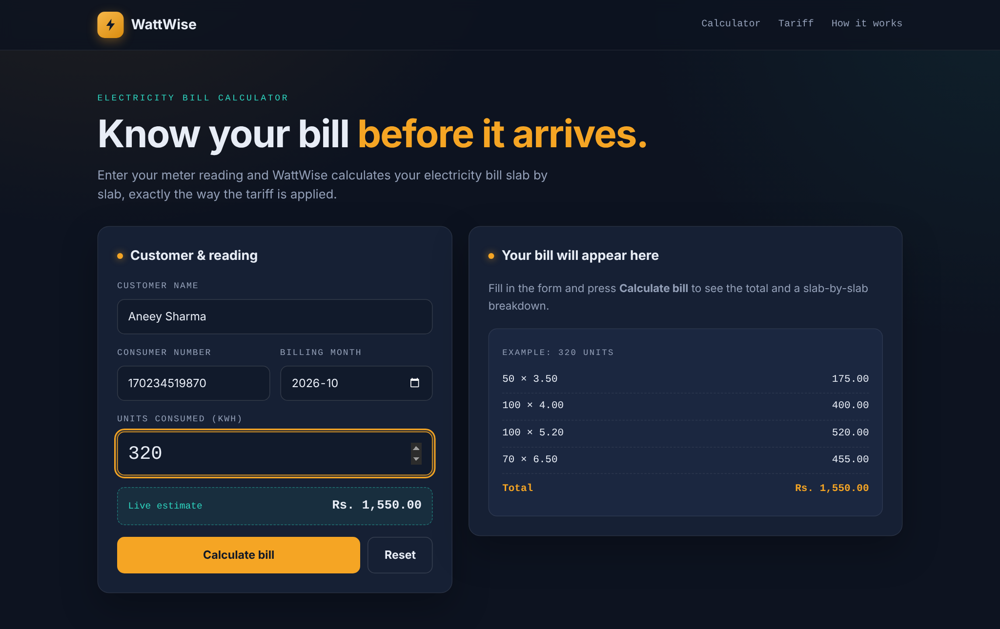
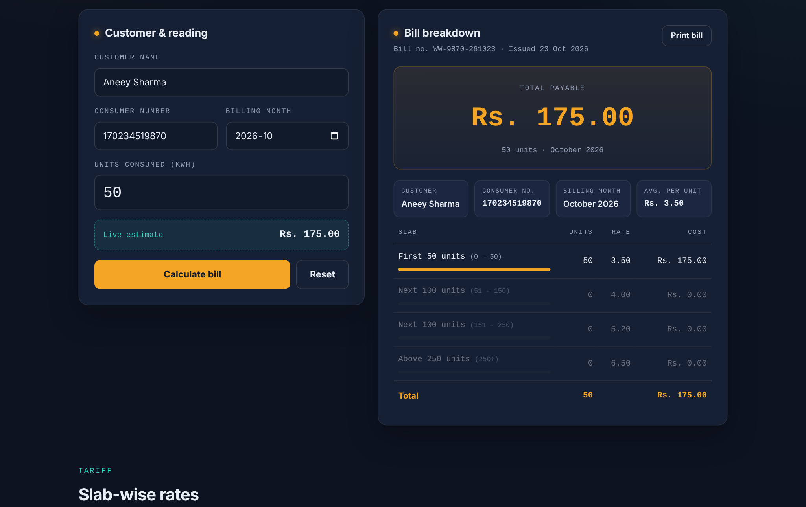
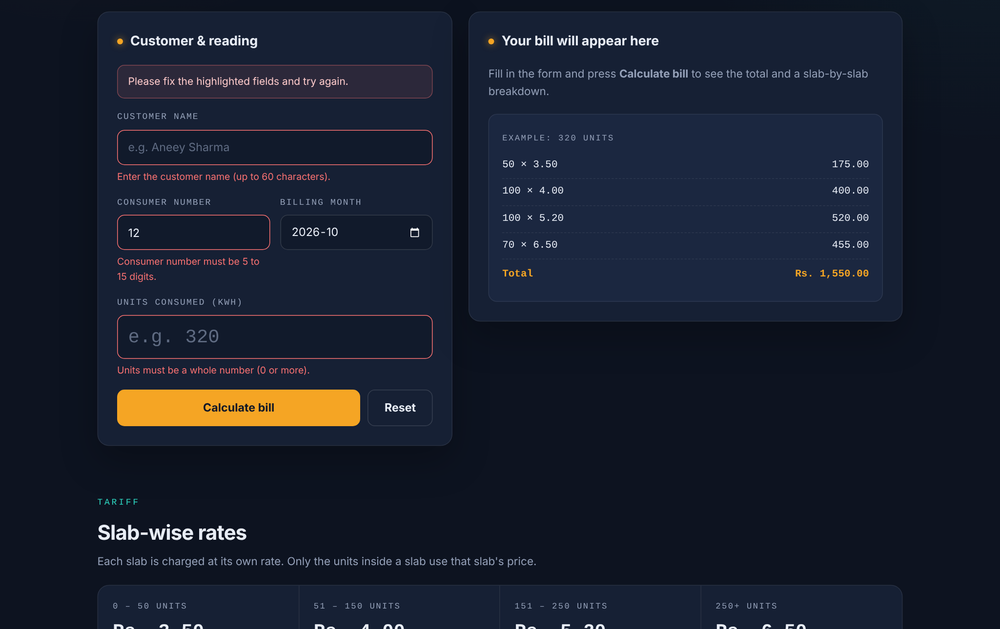
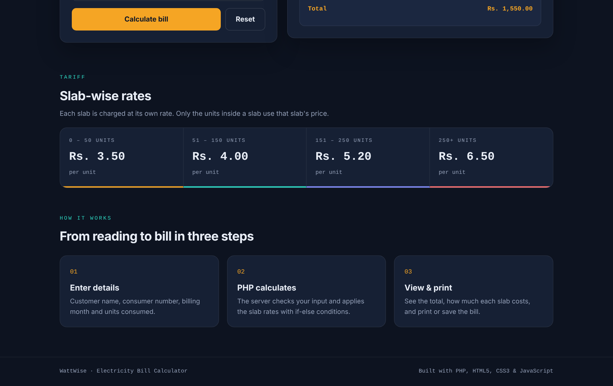
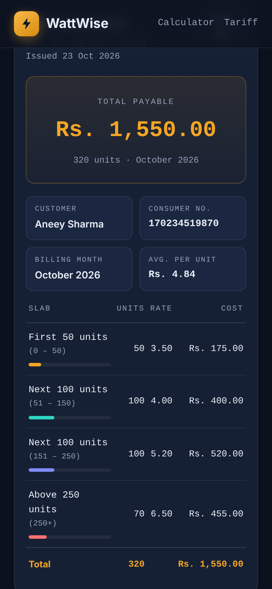

# ⚡ WattWise: Electricity Bill Calculator (PHP)

A responsive website that calculates an electricity bill from the units consumed using a **slab-wise tariff**. The calculation runs on the server in **PHP**.


## Problem Statement

Design and develop a responsive website, with the help of an AI code-generation tool, to calculate an electricity bill using PHP:

| Units | Rate |
|---|---|
| First 50 units | Rs. 3.50 / unit |
| Next 100 units (51–150) | Rs. 4.00 / unit |
| Next 100 units (151–250) | Rs. 5.20 / unit |
| Above 250 units | Rs. 6.50 / unit |

**Example:** 320 units = 50×3.50 + 100×4.00 + 100×5.20 + 70×6.50 = **Rs. 1,550.00**

## Features

- Form for customer name, consumer number, billing month and units consumed
- **PHP if-else slab calculation** with a slab-by-slab breakdown table and usage bars
- **Server-side validation** with clear error messages; the form keeps what you typed
- **Live estimate** while typing (JavaScript), with the official bill always from PHP
- Bill number, issue date and average cost per unit
- **Print / save as PDF** with a clean print layout
- **Responsive** on phones, tablets and desktops
- Safe output: all user input is escaped with `htmlspecialchars`
- Unit tests for every slab boundary

## Project Structure

```
electricity-bill-php/
├── index.php              # Form, validation and bill display
├── includes/
│   ├── billing.php        # calculate_bill(), slab_breakdown(), validation, helpers
│   ├── header.php         # Page head and navigation
│   └── footer.php         # Footer and script include
├── assets/
│   ├── css/style.css      # Theme, layout, responsive and print styles
│   └── js/script.js       # Live estimate and count-up animation
├── tests/
│   └── billing_test.php   # Slab boundary tests (php tests/billing_test.php)
└── screenshots/
```

## How to Run

**Option 1: PHP built-in server (PHP 7.4+)**
```bash
cd electricity-bill-php
php -S localhost:8000
```
Open http://localhost:8000

**Option 2: XAMPP / WAMP**
1. Copy the `electricity-bill-php` folder into `C:\xampp\htdocs\`
2. Start **Apache** from the XAMPP Control Panel
3. Open http://localhost/electricity-bill-php/

No database is needed.

**Run the tests**
```bash
php tests/billing_test.php
```

## Core Logic

```php
function calculate_bill(int $units): float
{
    if ($units <= 50) {
        $bill = $units * 3.50;
    } elseif ($units <= 150) {
        $bill = 50 * 3.50 + ($units - 50) * 4.00;
    } elseif ($units <= 250) {
        $bill = 50 * 3.50 + 100 * 4.00 + ($units - 150) * 5.20;
    } else {
        $bill = 50 * 3.50 + 100 * 4.00 + 100 * 5.20 + ($units - 250) * 6.50;
    }
    return round($bill, 2);
}
```

## Screenshots

| Live estimate | 50 units |
|---|---|
|  |  |
| **Validation** | **Tariff** |
|  |  |

<p align="center"></p>

## Tech Stack

PHP 8 · HTML5 · CSS3 · JavaScript
